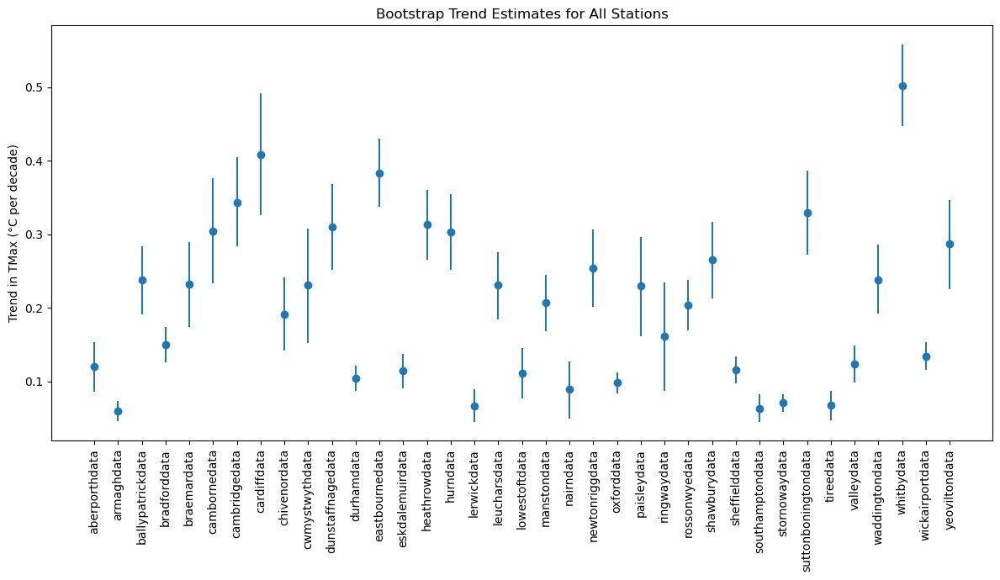
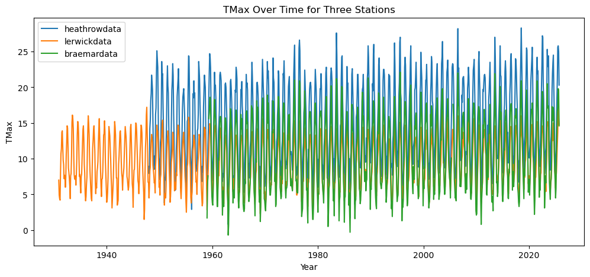
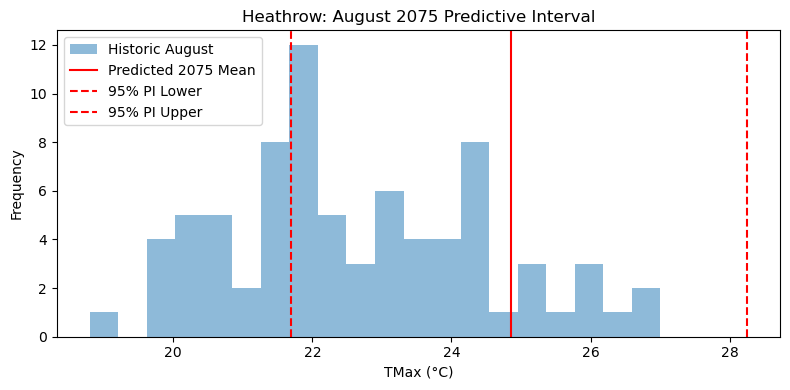

# UK Historic Weather Trends: Seasonal Regression and Bootstrap Analysis

A statistical analysis of long-running monthly weather records from 37 UK
stations. The project examines historical maximum-temperature trends,
geographical variation and changes in frost occurrence while separating
observed associations from causal climate attribution.

## Project snapshot

- Combined **39,427 monthly observations** from 37 weather stations.
- Modelled monthly mean daily maximum temperature using a linear trend and
  annual sine/cosine terms.
- Used **2,000-iteration residual bootstrapping** to estimate uncertainty in
  station-level temperature trends.
- Compared trend estimates across stations with different locations and record
  lengths.
- Produced exploratory August 2075 model extrapolations for Heathrow and
  Lerwick.
- Examined winter frost occurrence using chi-square tests across all stations.

## Questions

1. Do the station records show long-term changes in monthly maximum
   temperature?
2. How do estimated trends vary geographically across the 37 stations?
3. What does a seasonal trend model extrapolate for August 2075 at Heathrow
   and Lerwick?
4. Is frost occurrence associated with decade or year in the available
   records?

## Methods

The temperature model uses:

- a linear monthly time index;
- sine and cosine terms with a 12-month period; and
- ordinary least squares fitted separately to each station.

The original analysis resampled individual model residuals 2,000 times to
construct percentile intervals for each station's trend. Frost counts were
converted to a binary frost/no-frost indicator and examined using chi-square
tests of independence.

## Recorded results

The following values come from the saved original analysis:

| Result | Estimate |
|---|---:|
| Heathrow maximum-temperature trend | +0.313°C per decade |
| Heathrow residual-bootstrap interval | 0.266 to 0.360°C per decade |
| Lerwick maximum-temperature trend | +0.067°C per decade |
| Lerwick residual-bootstrap interval | 0.045 to 0.090°C per decade |
| Heathrow August 2075 model extrapolation | 24.86°C; interval 21.70–28.25°C |
| Lerwick August 2075 model extrapolation | 14.61°C; interval 12.54–16.65°C |
| Winter-frost tests with unadjusted p < 0.05 | 5 of 37 stations |
| Winter-frost tests with adjusted p < 0.05 | 2 of 37 stations (Valley and Stornoway) |

All 37 fitted temperature slopes were positive in the original calculation.
These values describe the fitted station models and should be interpreted with
the limitations below.

## Selected figures



The station-level fitted trends are shown with percentile intervals from the
original independent-residual bootstrap.



The raw records show strong seasonality, differing coverage periods and
substantial month-to-month variation.



The August 2075 output illustrates the fitted model's long-range extrapolation;
it is not a climate-model projection or operational forecast.

## Interpretation boundaries

- The analysis identifies historical statistical trends; it does not by itself
  attribute changes to a specific causal mechanism.
- Resampling individual residuals assumes independence and does not fully
  account for serial correlation in monthly weather data. A moving-block
  bootstrap or time-series model would provide stronger uncertainty estimates.
- The 2075 values are long-range linear-model extrapolations, not scenario-based
  climate projections.
- The 37 station records begin and end in different years, so their slopes do
  not all describe the same historical period.
- The five raw winter-frost results reduce to two after either Bonferroni or
  Benjamini–Hochberg correction.
- Chi-square assumptions are weak: 35 of 37 winter tables and all 37
  whole-year tables contain at least one expected cell below 5. The frost
  p-values are therefore exploratory rather than confirmatory.
- Failure to reject a chi-square null hypothesis is not evidence that frost
  occurrence is definitively stable.
- The source notes that no allowance has been made for small site changes or
  instrumentation developments, and some recent observations are provisional.

## Data source and licence

The data originate from the UK Met Office's
[historic station collection](https://www.metoffice.gov.uk/research/climate/maps-and-data/historic-station-data).
The official catalogue describes monthly maximum and minimum temperatures,
air-frost days, rainfall and sunshine duration for 37 long-running stations.

The dataset is published under the
[UK Open Government Licence](https://www.data.gov.uk/dataset/17ba3bbe-0e98-4a8c-9937-bd1d50fdc3c5/historic-monthly-meteorological-station-data).
The included snapshot carries the required Met Office attribution in
[`data/ATTRIBUTION.md`](data/ATTRIBUTION.md).

## Repository structure

```text
.
├── data/
│   ├── raw/weather_data/     # Metadata and 37 station CSV files
│   ├── ATTRIBUTION.md        # Source and reuse terms
│   └── README.md             # Dataset schema and caveats
├── notebooks/
│   └── uk_weather_trends_analysis.ipynb
├── results/                  # Selected figures and result summary
├── README.md
└── requirements.txt
```

## Reproduce the analysis

The notebook was verified with Python 3.11. From the repository root:

```bash
python -m venv .venv
source .venv/bin/activate
python -m pip install -r requirements.txt
jupyter lab
```

Open [`notebooks/uk_weather_trends_analysis.ipynb`](notebooks/uk_weather_trends_analysis.ipynb)
and run all cells. The notebook also works when launched from the `notebooks/`
directory because it locates the repository data automatically.
